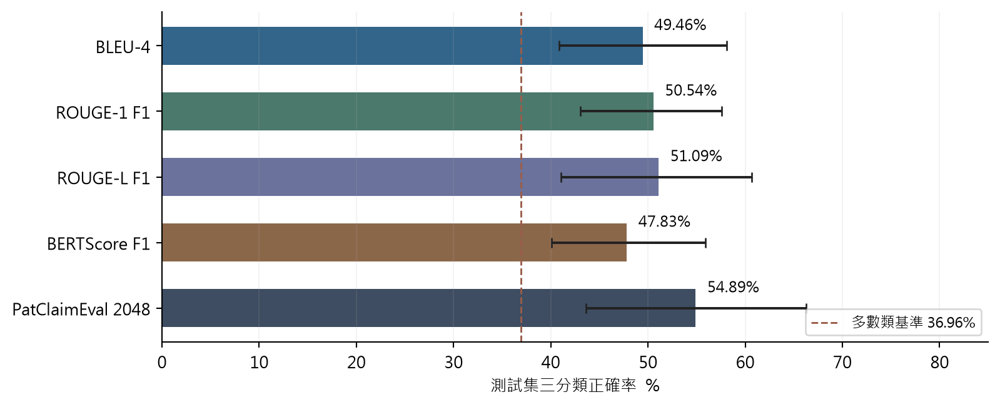

# Patent-CE 五項指標評估

本儲存庫公開 2026 年 10 月 19 日完成的 Patent-CE 評估結果、19 頁繁體中文報告、逐筆資料及重跑程式。評估全部 **1,228 筆比較**，其中 **1,044 筆訓練資料與 184 筆測試資料分開呈現**；沒有重新生成候選請求項或調整測試集門檻。

## 報告與資料

- [完整繁體中文 PDF 報告](outputs/patent_ce_evaluation_20261019_203847/Patent_CE_五項指標評估與專家答案比較報告.pdf)
- [可編輯 Word 報告](outputs/patent_ce_evaluation_20261019_203847/Patent_CE_五項指標評估與專家答案比較報告.docx)
- [完整報告與重跑資料 ZIP](outputs/patent_ce_evaluation_20261019_203847/Patent_CE_完整評估報告與重跑資料.zip)
- [逐筆評分 CSV](outputs/patent_ce_evaluation_20261019_203847/scores.csv)、[各子集摘要 CSV](outputs/patent_ce_evaluation_20261019_203847/summary.csv)
- [完整統計 JSON](outputs/patent_ce_evaluation_20261019_203847/results.json)、[欄位說明](outputs/patent_ce_evaluation_20261019_203847/data_dictionary.json)
- [數值核對紀錄](outputs/patent_ce_evaluation_20261019_203847/verification.json)、[逐頁排版檢查](outputs/patent_ce_evaluation_20261019_203847/qa_review.json)

## 測試集主要結果

正確率指「A 較佳、平手、B 較佳」的判斷與專家 `human_eval.Quality` 相同的比例。下表的 Macro-F1／Weighted-F1 是偏好分類成效，與 ROUGE／BERTScore 名稱中的文本相似度 F1 屬於不同層次。

| 評估方法 | 正確筆數 | 專家偏好判斷正確率 | 分類 Macro-F1 | 分類 Weighted-F1 |
| --- | ---: | ---: | ---: | ---: |
| BLEU-4 | 91 / 184 | 49.46% | 0.3811 | 0.4195 |
| ROUGE-1 F1 | 93 / 184 | 50.54% | 0.3915 | 0.4309 |
| ROUGE-L F1 | 94 / 184 | 51.09% | 0.3941 | 0.4338 |
| BERTScore F1 | 88 / 184 | 47.83% | 0.3798 | 0.4143 |
| PatClaimEval 2048 | 101 / 184 | 54.89% | 0.4495 | 0.4880 |

PatClaimEval 的正確率點估計最高，但與其他四項方法的成對差距之 95% 信賴區間都包含 0。多數類基準為 36.96%。信賴區間按參考文本分群重抽樣 10,000 次，固定 seed 42。



## 解讀限制

- 官方測試集的 20 組參考文本、186 個不同參考／候選配對，均出現在訓練集；其中 9 筆完整比較也重複。結果反映官方切分下已見候選的偏好一致程度，不能當作全新專利的泛化證據。
- 公開檔案只有整體品質 Quality 標籤，沒有逐候選絕對品質分數或逐筆專家理由。相似度與 PatClaimEval 分數都不是正確機率。
- 標準 BERTScore 使用 512-token 右側截斷，測試集 151／184 筆至少一段文字超長。PatClaimEval 的 2,048-token 上限影響 3 筆測試比較；另以 4,096 tokens 評分全部唯一配對，偏好判斷及正確率未改變。

## 評估規則

分別計算 `sA = score(gold_claim, A)` 與 `sB = score(gold_claim, B)`，保留來源原始字串，由各套件執行自身分詞。令 `delta = sA - sB`：`abs(delta) < 0.0001` 才判平手，否則依正負判 A 或 B 較佳；等於門檻仍保留勝負。門檻未用訓練或測試答案調整。

| 方法 | 設定 |
| --- | --- |
| BLEU-4 | Tokenizer13a，四階，不平滑，逐候選計算 |
| ROUGE-1 F1／ROUGE-L F1 | 逐候選 F1，不使用詞幹化 |
| BERTScore F1 | roberta-large 第17層，無IDF、不做baseline rescaling、slow tokenizer、512 tokens |
| PatClaimEval | 固定 Quality checkpoint、CPU float32、官方2,048及補充4,096 tokens |

224 個唯一參考／候選配對的分數回填為全部 1,228 筆比較，保留原始列權重。`predictions.csv` 含五項主要方法加一種長度設定，共 **7,368 個偏好判斷**。所有判斷已從 CSV 獨立核對，18 項測試與兩個模型的實際 checkpoint 續跑檢查均通過。

## 程式與重現

程式位於 [`public-programs/verification/patent_ce`](public-programs/verification/patent_ce)，入口為 [`run_patent_ce_evaluation.py`](public-programs/verification/run_patent_ce_evaluation.py)。[完整重跑說明](public-programs/verification/patent_ce/README.txt) 記錄原始 Windows、WSL 及文件產生環境。

只驗證已保存結果可使用 Python 3.12；Windows 的 Python 若沒有 IANA 時區資料，先安裝 `tzdata`：

```powershell
python public-programs/verification/run_patent_ce_evaluation.py --stage verify --output-dir outputs/patent_ce_evaluation_20261019_203847
```

完整評分使用本機固定模型、Windows 虛擬環境與 WSL；Word/PDF 產生依賴原始 Codex bundled runtime、Microsoft Word 及字型。原程式保留原始執行環境路徑；移至其他電腦須配置相同模型與套件並調整路徑。套件版本與模型 SHA-256 記錄在各 JSON／lock 檔。模型權重、虛擬環境及中間版本頁面影像不隨儲存庫提供。

## 資料來源與授權

Patent-CE 資料來自 [scylj1/PatClaimEval](https://github.com/scylj1/PatClaimEval)，固定 commit `8a9df74271be1330cf3b185c550e82513cf265f6`。上游 README 宣告 [**CC BY-NC 4.0**](https://creativecommons.org/licenses/by-nc/4.0/)；重散布的資料，以及結果檔與報告中重現的原始文本，仍遵循該授權的姓名標示與非商用條件。來源、模型版本及變更說明見 [NOTICE.txt](NOTICE.txt) 與原始 [UPSTREAM_README.md](data/Patent-CE/UPSTREAM_README.md)。

Jiang, Lekang; Scherz, Pascal A.; Goetz, Stefan. 2025. [Towards Better Evaluation for Generated Patent Claims](https://aclanthology.org/2025.acl-long.190/). ACL, 3775–3788. DOI: 10.18653/v1/2025.acl-long.190.

資料與主要評分產物均逐位元保留；新增 README、來源說明與發布檢查清單。原始執行紀錄中的本機路徑保留供稽核。檔案完整性可依 `SHA256SUMS.txt` 及原始 `delivery_manifest.json` 核對。
