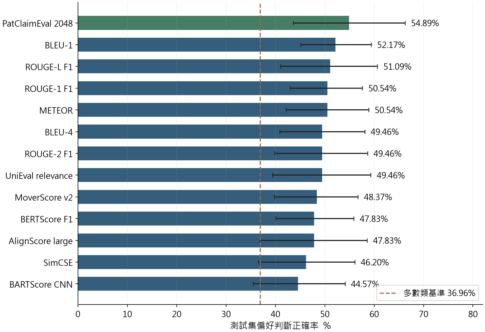
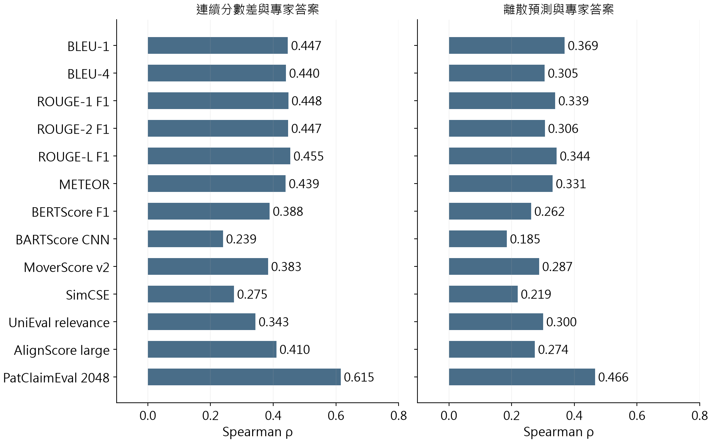
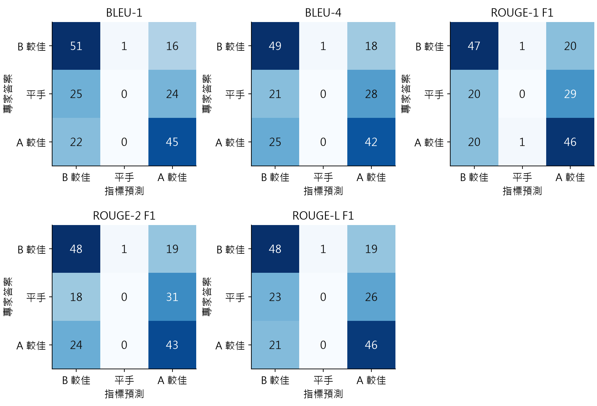
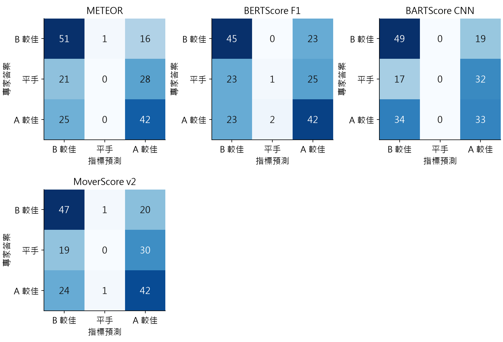
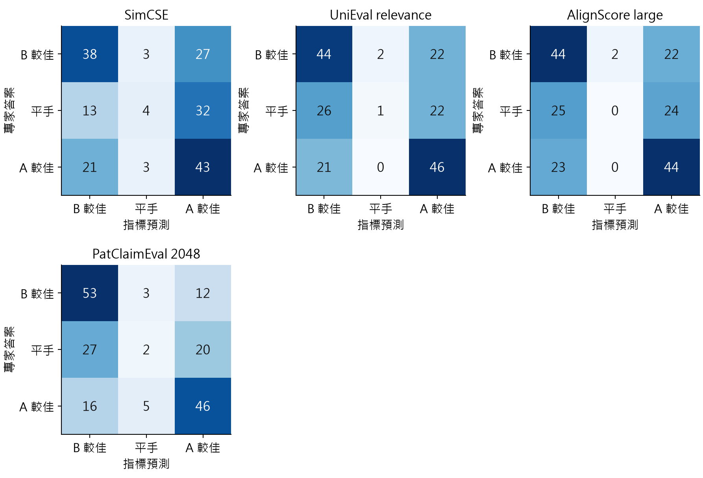

評估範圍  全部1,228筆比較  訓練1,044筆  測試184筆

執行識別  patent_ce_extended_20261019_230412  |  主要方法13項  |  G-Eval-4未執行

# 研究摘要

本報告重新評估公開Patent-CE資料，檢驗十三種自動方法對候選A、B的品質排序是否符合專家Quality答案。測試集正確率點估計最高者為PatClaimEval 2048，正確101／184筆，Accuracy 54.89%。各方法的Macro-F1與不確定性區間詳見主要結果表。

PatClaimEval 2048的Accuracy 95%信賴區間為43.64% 至 66.25%，Macro-F1為0.4495。相較次高的BLEU-1，Accuracy差距為+2.72個百分點，配對95%差距區間[-5.49, +10.78]個百分點。

最高點估計方法與其餘十二項方法的Accuracy及Macro-F1配對差距95%區間均包含0。依本次資料，尚不能確認其有明確優勢。

正確率是三分類偏好一致率；分數本身不是專利正確機率。方法間差異需結合按參考專利分群的信賴區間解讀，不能只以名次認定某方法穩定較佳。

公開檔案僅有Quality逐筆專家標籤。G-Eval-4依本次範圍未使用付費API；Completeness、Clarity、Consistency、Linkage不產生自行推測的成效。各新增方法採明確宣告設定，與原論文未公開的細節不保證一致。

測試資料的全部參考與候選配對均曾出現在訓練集。本文結論限定官方切分下對已見候選的偏好一致程度，不作未見專利泛化推論。

# 資料與專家答案

每筆包含參考請求項gold_claim、候選A、候選B與human_eval.Quality。標籤1表示A較佳、0表示平手、-1表示B較佳。所有原始字串逐位元保留，不自行整理空白或改寫換行；各方法自行分詞的行為另行記錄。

| 資料切分 | 比較數 | 參考組數 | A較佳 | 平手 | B較佳 |

| --- | --- | --- | --- | --- | --- |

| train | 1044 | 20 | 355 | 333 | 356 |

| test | 184 | 20 | 67 | 49 | 68 |

1,228筆比較包含224組不同的「原始參考文字、原始候選文字」配對。每方法先評分唯一配對，再回填各列；去重只節省推論，主要統計仍依原始列數加權。

| 稽核項目 | 結果 |

| --- | --- |

| 測試參考是否見於訓練 | 20組全部曾出現 |

| 測試不同參考／候選配對 | 186組全部曾出現 |

| 測試與訓練重複比較 | 9筆，A／B交換亦納入檢查 |

| 測試含原文gold候選 | 28筆 |

| 訓練完全重複列 | 20筆，補充去重後1,024筆結果 |

# 方法設定與分數方向

| 方法 | 固定設定 |

| --- | --- |

| BLEU-1／BLEU-4 | Tokenizer13a；max_order=1／4；smooth=False；逐候選。 |

| ROUGE-1／2／L F1 | 逐候選 F1；不使用詞幹化，非 corpus 平均回填。 |

| METEOR | NLTK tokenize／WordNet；α=0.9、β=3、γ=0.5；逐配對計算。 |

| BERTScore F1 | roberta-large 第17層；IDF 關閉；baseline rescaling 關閉；slow tokenizer；512 tokens。 |

| BARTScore CNN | facebook/bart-large-cnn；gold→candidate；來源及目標各1,024 tokens；平均目標token log probability，通常為負數，越高越好。 |

| MoverScore v2 | distilbert-base-uncased；512 tokens；最後一層；unigram；移除 subwords／標點；stopwords=[]。 |

| SimCSE | sup-simcse-bert-base-uncased；supervised CLS pooler；128 tokens；配對 cosine。 |

| UniEval relevance | MingZhong/unieval-sum；只計 relevance；output=candidate、reference=gold、source 空字串；合併輸入1,024。 |

| AlignScore large | large checkpoint／roberta-large；gold=context、candidate=claim；nli_sp；官方分句與分塊聚合。 |

| PatClaimEval | 固定 Quality checkpoint；官方2,048 tokens；4,096 tokens 為附加敏感度設定。 |

十三項方法均以分數較高為較佳；各方法分數都不是答案正確的機率。

BARTScore是平均目標token log probability，數值通常為負，較接近零較佳，不能取絕對值後判勝負。SimCSE只取一對文字的cosine，不把所有配對形成的矩陣平均。UniEval只使用relevance，不能將其原生構面名稱當作專利四個構面的人工答案。

原文保留是指不在方法外先改寫資料。Tokenizer13a本身會處理HTML實體、換行與部分標點，並按空白分詞，保留大小寫；ROUGE預設tokenizer會轉小寫，以空白替代非a–z／0–9字元，且本次不做詞幹化。METEOR使用NLTK分詞，內部採預設小寫、Porter詞幹及WordNet同義詞匹配。神經方法使用各自固定的tokenizer；DistilBERT與本次SimCSE為uncased設定。這些方法內部處理和特殊token均不會回寫覆蓋CSV中的來源原文。

# 各方法分數的含義

BLEU-1衡量候選unigram的裁切匹配精確率，再乘上過短候選的長度懲罰。BLEU-4將1至4-gram精確率作等權幾何平均，再乘同一懲罰；本次不平滑，任一必要階的精確率為零時，整體分數即為零。它們強調局部詞序與字面重疊。

ROUGE-1與ROUGE-2分別依unigram與bigram重疊計算precision、recall，再取F1。ROUGE-L以最長共同子序列的長度計算兩者，容許中間插入不同詞語，但仍依賴詞彙與相對順序。

METEOR依序匹配原詞、詞幹及WordNet同義詞，再計算偏重recall的加權調和平均，並以匹配片段的破碎程度扣分。因此即使重疊詞數相近，排列與同義詞匹配仍可能改變分數。

BERTScore先為參考與候選的各token建立上下文向量，再以最佳token匹配的相似度形成precision與recall，最後取F1。它的F1是在文本配對內聚合向量相似度，與本報告跨184筆偏好分類計算的Macro-F1不同。

BARTScore是把gold當輸入時，模型對候選各目標token的條件對數機率取平均；越容易在該模型下生成，分數越高。這是生成模型的條件分數，不能當作專家品質正確率。

MoverScore v2為上下文token向量與訓練語料IDF建立加權分布，以Earth Mover’s Distance求搬運成本，將成本轉成越高越好的相似度。參考與候選使用各自IDF，故即使原文複製也不保證剛好得到1。SimCSE則將兩段文本各壓成supervised CLS句向量，再取配對cosine；本次只使用各段開頭最多128 tokens。

UniEval relevance透過固定問題模板，取模型回答Yes相對於Yes與No的權重作為相關程度。這個模型內部的二選一歸一化分數，也不是對Patent-CE專家答案校準後的機率。

AlignScore nli_sp將每個候選句子與參考片段配對，先取該候選句子在參考片段上的最佳對齊，再平均各候選句子的分數。它評估句子被參考內容支持的程度；分句、分塊與每次模型輸入的截斷共同決定實際可見內容。

PatClaimEval使用固定Quality權重對參考與候選產生品質分數。本報告把同一參考下A、B的分數差轉成偏好，再與公開專家標籤核對；沒有逐候選的絕對人工分數可用來計算絕對品質誤差。

# 實作相容性與可重現性

既有五項主要方法與PatClaimEval長度變體從前次固定產物匯入，不重新推論。來源交付清單、資料、設定及本機模型檔案均經SHA-256核對，所有候選分數未四捨五入。新方法在隔離WSL環境執行，保留舊程式及環境。

新增神經方法使用Python 3.10.20、PyTorch 1.13.1 CPU、Transformers 4.26.1、NumPy 1.23.5及Lightning 1.9.5；CPU float32、4 threads、batch size 1、seed 42。固定官方原始碼與模型revision，完整程式差異、模型檔案hash與套件鎖定檔隨附件保存。

適配器處理CPU裝置、模型載入及套件介面相容；AlignScore另快取完全相同的參考片段／候選句子之三個原生輸出head，保留原有分塊、分詞與max／mean聚合。小樣本比對明確繞過快取執行官方函式，確認數值在10⁻⁵誤差內一致。

初始三組smoke包含gold-copy與最長配對。稽核後另於正式推論完成時補驗真正最短的1,354字元配對，以及最接近全體中位數的5,746字元配對；長度為原始參考加候選的Unicode字元總數。八個新增方法均再次對官方函式與正式分數核對，未改動評分設定、模型或門檻。補驗使用獨立輸入及checkpoint，MoverScore仍保留全部訓練原文建立IDF。此補驗時序與原定事前涵蓋短、中、長樣本的安排不同，完整紀錄見supplemental_sample_validation.json。

AlignScore評分也略去未被三個評分head使用的MLM詞彙logits；完整模型模組與checkpoint參數仍保留，僅在eval且沒有MLM標籤時省算。對同一輸入執行原始與優化forward，三個head逐張量完全相等；最終smoke另以無快取、未省算的原始函式核對整體分數。證據見alignscore_optimization_validation.json。

MoverScore明確使用官方v2 DistilBERT版本，不視為原始BERT-MNLI版本的完全重現。參考IDF與候選IDF分別由訓練集去重原文建立，固定保存；不使用測試人工答案建立權重或調整設定。

所有指標使用原始分數尺度及相同平手門檻；尺度差異會影響平手頻率，因此本文同時列出平手召回率、非平手正確率及分數差分布。沒有以測試資料校準分數或挑選門檻。

# 執行時間與小樣本資源

| 新增方法 | 正式224對時間 分 | 補驗2對程序時間 分 | 補驗首次程序峰值 GiB |

| --- | --- | --- | --- |

| BLEU-1 | 0.09 | 0.07 | 0.218 |

| ROUGE-2 F1 | 0.09 | 0.08 | 0.286 |

| METEOR | 0.19 | 0.11 | 0.458 |

| BARTScore CNN | 9.27 | 0.64 | 3.469 |

| MoverScore v2 | 25.62 | 0.34 | 0.729 |

| SimCSE | 0.55 | 0.20 | 1.092 |

| UniEval relevance | 14.63 | 1.18 | 6.085 |

| AlignScore large | 98.94 | 4.87 | 7.736 |

正式時間為worker保存的首次elapsed_seconds，保留零新增推論續跑前的數值。補驗時間與記憶體由GNU /usr/bin/time -v實測整個獨立worker子程序，包含載入、兩組樣本、官方函式核對及續跑驗證；不是正式224對的峰值，也不是模型參數本身的大小。GiB按GNU time kbytes除以1,048,576換算。

補驗資源量測於完整正式推論後進行；首次程序與後續純續跑的紀錄分開保留，避免低記憶體的續跑程序覆蓋原始峰值。原始量測文字及SHA-256隨附件保存。上述時間只描述本機此次執行，不作跨硬體速度結論。

# 偏好判斷與統計公式

令 Δ = score(gold,A) − score(gold,B)。僅當 |Δ| < 0.0001 時判為平手；等於門檻仍依正負判勝負。Accuracy = 正確筆數／比較筆數。各類F1 = 2TP／(2TP+FP+FN)；Macro-F1為三類等權平均，Weighted-F1按專家類別支持筆數加權。分母為零時該類指標設為0。

Kendall τ-b納入平手校正，Spearman ρ為秩相關。連續版本以Δ對專家標籤計算；離散版本以三分類預測對專家標籤計算。常數輸出無法定義相關係數時標為不適用。

# 測試集主要結果

| 方法 | 正確筆數 | Accuracy | 95% 區間 | Macro-F1 | Weighted-F1 |

| --- | --- | --- | --- | --- | --- |

| BLEU-1 | 96／184 | 52.17% | 45.16% 至 59.39% | 0.4022 | 0.4427 |

| BLEU-4 | 91／184 | 49.46% | 40.84% 至 58.10% | 0.3811 | 0.4195 |

| ROUGE-1 F1 | 93／184 | 50.54% | 43.02% 至 57.61% | 0.3915 | 0.4309 |

| ROUGE-2 F1 | 91／184 | 49.46% | 39.88% 至 58.66% | 0.3817 | 0.4203 |

| ROUGE-L F1 | 94／184 | 51.09% | 41.04% 至 60.66% | 0.3941 | 0.4338 |

| METEOR | 93／184 | 50.54% | 42.13% 至 58.90% | 0.3891 | 0.4284 |

| BERTScore F1 | 88／184 | 47.83% | 40.09% 至 55.88% | 0.3798 | 0.4143 |

| BARTScore CNN | 82／184 | 44.57% | 35.48% 至 54.10% | 0.3401 | 0.3747 |

| MoverScore v2 | 89／184 | 48.37% | 39.78% 至 56.73% | 0.3744 | 0.4122 |

| SimCSE | 85／184 | 46.20% | 36.59% 至 56.08% | 0.3958 | 0.4220 |

| UniEval relevance | 91／184 | 49.46% | 39.39% 至 59.32% | 0.3926 | 0.4282 |

| AlignScore large | 88／184 | 47.83% | 36.81% 至 58.59% | 0.3702 | 0.4074 |

| PatClaimEval 2048 | 101／184 | 54.89% | 43.64% 至 66.25% | 0.4495 | 0.4880 |

上表為全部184筆官方測試比較，未排除困難、超長或重複資料。Macro-F1與Weighted-F1是偏好分類成效，和ROUGE／BERTScore名稱中的文本相似度F1不同。

多數類基準只依訓練集決定，固定預測「B 較佳」。測試集正確68／184筆，Accuracy 36.96%，Macro-F1 0.1799，Weighted-F1 0.1994；未用測試答案選擇基準類別。

# 正確率與分群不確定性

信賴區間按完整gold文字形成參考專利群組，每次從g個群組有放回抽g次，保留群組內原始列權重。共10,000次，seed 42；同一抽樣用於所有方法，故能估計成對差異。群組數僅20，區間仍可能較寬。

| PatClaimEval 對照方法 | 差距百分點 | 差距95%區間 百分點 | 區間是否含0 |

| --- | --- | --- | --- |

| BLEU-1 | +2.72 | [-5.49, +10.78] | 包含0 |

| BLEU-4 | +5.43 | [-4.19, +14.29] | 包含0 |

| ROUGE-1 F1 | +4.35 | [-5.78, +13.79] | 包含0 |

| ROUGE-2 F1 | +5.43 | [-6.25, +15.93] | 包含0 |

| ROUGE-L F1 | +3.80 | [-7.73, +14.91] | 包含0 |

| METEOR | +4.35 | [-7.14, +15.44] | 包含0 |

| BERTScore F1 | +7.07 | [-4.89, +18.72] | 包含0 |

| BARTScore CNN | +10.33 | [-3.78, +24.14] | 包含0 |

| MoverScore v2 | +6.52 | [-4.07, +17.68] | 包含0 |

| SimCSE | +8.70 | [-5.21, +22.09] | 包含0 |

| UniEval relevance | +5.43 | [-7.02, +17.78] | 包含0 |

| AlignScore large | +7.07 | [-8.12, +20.77] | 包含0 |

此處區間為探索性成對比較，未作多重比較校正；只有點估計較高不足以認定穩定優勢。全部78組主要方法配對差異詳見JSON與附件。

# 與專家答案的相關係數

| 方法 | 連續 τ-b | 連續 ρ | 離散 τ-b | 離散 ρ |

| --- | --- | --- | --- | --- |

| BLEU-1 | 0.3521 | 0.4467 | 0.3472 | 0.3691 |

| BLEU-4 | 0.3475 | 0.4404 | 0.2874 | 0.3054 |

| ROUGE-1 F1 | 0.3534 | 0.4481 | 0.3176 | 0.3389 |

| ROUGE-2 F1 | 0.3542 | 0.4472 | 0.2881 | 0.3060 |

| ROUGE-L F1 | 0.3594 | 0.4545 | 0.3232 | 0.3436 |

| METEOR | 0.3448 | 0.4394 | 0.3115 | 0.3309 |

| BERTScore F1 | 0.3031 | 0.3884 | 0.2459 | 0.2624 |

| BARTScore CNN | 0.1879 | 0.2394 | 0.1744 | 0.1847 |

| MoverScore v2 | 0.3002 | 0.3831 | 0.2694 | 0.2875 |

| SimCSE | 0.2145 | 0.2746 | 0.2035 | 0.2193 |

| UniEval relevance | 0.2677 | 0.3433 | 0.2816 | 0.3005 |

| AlignScore large | 0.3237 | 0.4098 | 0.2569 | 0.2741 |

| PatClaimEval 2048 | 0.4895 | 0.6151 | 0.4289 | 0.4658 |

連續相關反映分數差與專家偏好之間的排序關係；離散相關反映經平手門檻轉換後的預測排序。兩者資料輸入不同，不應互換，也不能直接解讀成正確率。

# 訓練集描述結果

| 方法 | 正確筆數 | Accuracy | 95% 區間 | Macro-F1 | Weighted-F1 |

| --- | --- | --- | --- | --- | --- |

| BLEU-1 | 537／1044 | 51.44% | 45.72% 至 56.59% | 0.4244 | 0.4322 |

| BLEU-4 | 531／1044 | 50.86% | 46.40% 至 55.17% | 0.4200 | 0.4277 |

| ROUGE-1 F1 | 511／1044 | 48.95% | 42.42% 至 54.93% | 0.4065 | 0.4138 |

| ROUGE-2 F1 | 513／1044 | 49.14% | 42.95% 至 54.91% | 0.4065 | 0.4139 |

| ROUGE-L F1 | 516／1044 | 49.43% | 43.44% 至 55.00% | 0.4101 | 0.4175 |

| METEOR | 503／1044 | 48.18% | 43.13% 至 52.92% | 0.3990 | 0.4063 |

| BERTScore F1 | 508／1044 | 48.66% | 44.49% 至 52.62% | 0.4027 | 0.4100 |

| BARTScore CNN | 461／1044 | 44.16% | 38.77% 至 49.41% | 0.3544 | 0.3617 |

| MoverScore v2 | 519／1044 | 49.71% | 46.30% 至 53.21% | 0.4187 | 0.4257 |

| SimCSE | 498／1044 | 47.70% | 41.03% 至 53.98% | 0.4259 | 0.4313 |

| UniEval relevance | 497／1044 | 47.61% | 41.94% 至 53.33% | 0.3919 | 0.3992 |

| AlignScore large | 503／1044 | 48.18% | 42.34% 至 53.25% | 0.4002 | 0.4073 |

| PatClaimEval 2048 | 615／1044 | 58.91% | 52.07% 至 64.59% | 0.5088 | 0.5168 |

訓練集成效為描述性結果。PatClaimEval權重曾以相關資料訓練，且官方切分有內容重疊；訓練成效不能當作獨立驗證。主要比較仍以測試集為準。

# Macro F1分群信賴區間

| 方法 | 測試Macro-F1 | 測試95%區間 | 訓練Macro-F1 | 訓練95%區間 |

| --- | --- | --- | --- | --- |

| BLEU-1 | 0.4022 | [0.3505, 0.4484] | 0.4244 | [0.3794, 0.4635] |

| BLEU-4 | 0.3811 | [0.3216, 0.4351] | 0.4200 | [0.3842, 0.4539] |

| ROUGE-1 F1 | 0.3915 | [0.3417, 0.4318] | 0.4065 | [0.3551, 0.4509] |

| ROUGE-2 F1 | 0.3817 | [0.3145, 0.4400] | 0.4065 | [0.3577, 0.4506] |

| ROUGE-L F1 | 0.3941 | [0.3222, 0.4558] | 0.4101 | [0.3639, 0.4503] |

| METEOR | 0.3891 | [0.3313, 0.4395] | 0.3990 | [0.3571, 0.4371] |

| BERTScore F1 | 0.3798 | [0.3221, 0.4307] | 0.4027 | [0.3641, 0.4334] |

| BARTScore CNN | 0.3401 | [0.2738, 0.4045] | 0.3544 | [0.3118, 0.3916] |

| MoverScore v2 | 0.3744 | [0.3143, 0.4283] | 0.4187 | [0.3833, 0.4508] |

| SimCSE | 0.3958 | [0.3153, 0.4841] | 0.4259 | [0.3667, 0.4796] |

| UniEval relevance | 0.3926 | [0.3141, 0.4651] | 0.3919 | [0.3447, 0.4365] |

| AlignScore large | 0.3702 | [0.2945, 0.4396] | 0.4002 | [0.3520, 0.4393] |

| PatClaimEval 2048 | 0.4495 | [0.3665, 0.5260] | 0.5088 | [0.4636, 0.5432] |

Macro-F1區間採與Accuracy相同的參考專利分群抽樣。全部方法間的Accuracy及Macro-F1配對差距區間保存在results.json。

# 平手與方向性錯誤

| 方法 | 錯誤率 | 平手召回 | 非平手正確率 | 完全判反率 |

| --- | --- | --- | --- | --- |

| BLEU-1 | 47.83% | 0.00% | 71.11% | 28.15% |

| BLEU-4 | 50.54% | 0.00% | 67.41% | 31.85% |

| ROUGE-1 F1 | 49.46% | 0.00% | 68.89% | 29.63% |

| ROUGE-2 F1 | 50.54% | 0.00% | 67.41% | 31.85% |

| ROUGE-L F1 | 48.91% | 0.00% | 69.63% | 29.63% |

| METEOR | 49.46% | 0.00% | 68.89% | 30.37% |

| BERTScore F1 | 52.17% | 2.04% | 64.44% | 34.07% |

| BARTScore CNN | 55.43% | 0.00% | 60.74% | 39.26% |

| MoverScore v2 | 51.63% | 0.00% | 65.93% | 32.59% |

| SimCSE | 53.80% | 8.16% | 60.00% | 35.56% |

| UniEval relevance | 50.54% | 2.04% | 66.67% | 31.85% |

| AlignScore large | 52.17% | 0.00% | 65.19% | 33.33% |

| PatClaimEval 2048 | 45.11% | 4.08% | 73.33% | 20.74% |

平手召回率的分母為專家判平手的49筆；非平手正確率與完全判反率的分母為專家有明確偏好的135筆。完全判反是專家判A較佳卻預測B，或專家判B較佳卻預測A；預測平手屬其他錯誤，不計為完全判反。

# 候選分數與分數差分布

| 方法 | A平均 | B平均 | Δ第1四分位 | Δ中位數 | Δ第3四分位 | 預測平手數 |

| --- | --- | --- | --- | --- | --- | --- |

| BLEU-1 | 0.5585 | 0.5784 | -0.1225 | -0.0081 | 0.1035 | 1 |

| BLEU-4 | 0.4109 | 0.4395 | -0.1286 | -0.0030 | 0.0863 | 1 |

| ROUGE-1 F1 | 0.6716 | 0.6832 | -0.0816 | 0.0022 | 0.0707 | 2 |

| ROUGE-2 F1 | 0.5263 | 0.5471 | -0.1053 | 0.0007 | 0.0799 | 1 |

| ROUGE-L F1 | 0.5521 | 0.5634 | -0.0766 | -0.0004 | 0.0796 | 1 |

| METEOR | 0.5487 | 0.5692 | -0.0919 | -0.0054 | 0.0707 | 1 |

| BERTScore F1 | 0.9057 | 0.9068 | -0.0135 | 0.0000 | 0.0170 | 3 |

| BARTScore CNN | -1.5072 | -1.4097 | -0.4721 | -0.0291 | 0.2678 | 0 |

| MoverScore v2 | 0.6696 | 0.6774 | -0.0263 | 0.0001 | 0.0253 | 2 |

| SimCSE | 0.8818 | 0.8803 | -0.0253 | 0.0026 | 0.0323 | 10 |

| UniEval relevance | 0.9299 | 0.9354 | -0.0304 | -0.0000 | 0.0179 | 3 |

| AlignScore large | 0.4440 | 0.4483 | -0.0867 | -0.0019 | 0.0986 | 2 |

| PatClaimEval 2048 | 0.3051 | 0.3252 | -0.0258 | -0.0002 | 0.0128 | 10 |

分數分布只在相同方法內比較。各方法尺度、訓練目標與截斷規則不同，不能將其平均分數橫向相減，或將數值接近1解讀為內容幾乎完全正確。Δ為未四捨五入的A分數減B分數；本表顯示到四位小數，平手判斷仍使用完整精度。

# 混淆矩陣與各類別成效 第1組

| 方法 | 專家類別 | Precision | Recall | F1 | 支持筆數 |

| --- | --- | --- | --- | --- | --- |

| BLEU-1 | B 較佳 | 0.5204 | 0.7500 | 0.6145 | 68 |

| BLEU-1 | 平手 | 0.0000 | 0.0000 | 0.0000 | 49 |

| BLEU-1 | A 較佳 | 0.5294 | 0.6716 | 0.5921 | 67 |

| BLEU-4 | B 較佳 | 0.5158 | 0.7206 | 0.6012 | 68 |

| BLEU-4 | 平手 | 0.0000 | 0.0000 | 0.0000 | 49 |

| BLEU-4 | A 較佳 | 0.4773 | 0.6269 | 0.5419 | 67 |

| ROUGE-1 F1 | B 較佳 | 0.5402 | 0.6912 | 0.6065 | 68 |

| ROUGE-1 F1 | 平手 | 0.0000 | 0.0000 | 0.0000 | 49 |

| ROUGE-1 F1 | A 較佳 | 0.4842 | 0.6866 | 0.5679 | 67 |

| ROUGE-2 F1 | B 較佳 | 0.5333 | 0.7059 | 0.6076 | 68 |

| ROUGE-2 F1 | 平手 | 0.0000 | 0.0000 | 0.0000 | 49 |

| ROUGE-2 F1 | A 較佳 | 0.4624 | 0.6418 | 0.5375 | 67 |

| ROUGE-L F1 | B 較佳 | 0.5217 | 0.7059 | 0.6000 | 68 |

| ROUGE-L F1 | 平手 | 0.0000 | 0.0000 | 0.0000 | 49 |

| ROUGE-L F1 | A 較佳 | 0.5055 | 0.6866 | 0.5823 | 67 |

# 混淆矩陣與各類別成效 第2組

| 方法 | 專家類別 | Precision | Recall | F1 | 支持筆數 |

| --- | --- | --- | --- | --- | --- |

| METEOR | B 較佳 | 0.5258 | 0.7500 | 0.6182 | 68 |

| METEOR | 平手 | 0.0000 | 0.0000 | 0.0000 | 49 |

| METEOR | A 較佳 | 0.4884 | 0.6269 | 0.5490 | 67 |

| BERTScore F1 | B 較佳 | 0.4945 | 0.6618 | 0.5660 | 68 |

| BERTScore F1 | 平手 | 0.3333 | 0.0204 | 0.0385 | 49 |

| BERTScore F1 | A 較佳 | 0.4667 | 0.6269 | 0.5350 | 67 |

| BARTScore CNN | B 較佳 | 0.4900 | 0.7206 | 0.5833 | 68 |

| BARTScore CNN | 平手 | 0.0000 | 0.0000 | 0.0000 | 49 |

| BARTScore CNN | A 較佳 | 0.3929 | 0.4925 | 0.4371 | 67 |

| MoverScore v2 | B 較佳 | 0.5222 | 0.6912 | 0.5949 | 68 |

| MoverScore v2 | 平手 | 0.0000 | 0.0000 | 0.0000 | 49 |

| MoverScore v2 | A 較佳 | 0.4565 | 0.6269 | 0.5283 | 67 |

# 混淆矩陣與各類別成效 第3組

| 方法 | 專家類別 | Precision | Recall | F1 | 支持筆數 |

| --- | --- | --- | --- | --- | --- |

| SimCSE | B 較佳 | 0.5278 | 0.5588 | 0.5429 | 68 |

| SimCSE | 平手 | 0.4000 | 0.0816 | 0.1356 | 49 |

| SimCSE | A 較佳 | 0.4216 | 0.6418 | 0.5089 | 67 |

| UniEval relevance | B 較佳 | 0.4835 | 0.6471 | 0.5535 | 68 |

| UniEval relevance | 平手 | 0.3333 | 0.0204 | 0.0385 | 49 |

| UniEval relevance | A 較佳 | 0.5111 | 0.6866 | 0.5860 | 67 |

| AlignScore large | B 較佳 | 0.4783 | 0.6471 | 0.5500 | 68 |

| AlignScore large | 平手 | 0.0000 | 0.0000 | 0.0000 | 49 |

| AlignScore large | A 較佳 | 0.4889 | 0.6567 | 0.5605 | 67 |

| PatClaimEval 2048 | B 較佳 | 0.5521 | 0.7794 | 0.6463 | 68 |

| PatClaimEval 2048 | 平手 | 0.2000 | 0.0408 | 0.0678 | 49 |

| PatClaimEval 2048 | A 較佳 | 0.5897 | 0.6866 | 0.6345 | 67 |

# 資料重複與gold-copy敏感度

| 方法 | 測試全部 | 測試去重複 | 測試去gold | 訓練去重 |

| --- | --- | --- | --- | --- |

| BLEU-1 | 52.17% | 53.71% | 43.59% | 51.66% |

| BLEU-4 | 49.46% | 51.43% | 40.38% | 51.17% |

| ROUGE-1 F1 | 50.54% | 52.57% | 41.67% | 49.32% |

| ROUGE-2 F1 | 49.46% | 50.86% | 40.38% | 49.41% |

| ROUGE-L F1 | 51.09% | 53.14% | 42.31% | 49.80% |

| METEOR | 50.54% | 52.00% | 41.67% | 48.34% |

| BERTScore F1 | 47.83% | 48.57% | 38.46% | 48.93% |

| BARTScore CNN | 44.57% | 46.29% | 34.62% | 44.14% |

| MoverScore v2 | 48.37% | 49.14% | 39.10% | 49.90% |

| SimCSE | 46.20% | 47.43% | 37.18% | 47.75% |

| UniEval relevance | 49.46% | 50.86% | 44.87% | 47.66% |

| AlignScore large | 47.83% | 49.14% | 39.74% | 48.54% |

| PatClaimEval 2048 | 54.89% | 56.00% | 50.00% | 59.18% |

測試去重複排除與訓練重複的9筆，剩175筆；測試去gold排除任一候選逐字等於gold的28筆，剩156筆；兩種排除分別計算。訓練去重排除20筆完全重複紀錄，剩1,024筆。這些補充結果不能消除所有訓練／測試內容重疊。

# 長文本截斷與分塊

| 方法 | 訓練至少一側截斷 | 測試至少一側截斷 |

| --- | --- | --- |

| BLEU-1 | 0／1044；未知0 | 0／184；未知0 |

| BLEU-4 | 0／1044；未知0 | 0／184；未知0 |

| ROUGE-1 F1 | 0／1044；未知0 | 0／184；未知0 |

| ROUGE-2 F1 | 0／1044；未知0 | 0／184；未知0 |

| ROUGE-L F1 | 0／1044；未知0 | 0／184；未知0 |

| METEOR | 0／1044；未知0 | 0／184；未知0 |

| BERTScore F1 | 872／1044；未知0 | 151／184；未知0 |

| BARTScore CNN | 133／1044；未知0 | 18／184；未知0 |

| MoverScore v2 | 871／1044；未知0 | 151／184；未知0 |

| SimCSE | 1044／1044；未知0 | 184／184；未知0 |

| UniEval relevance | 868／1044；未知0 | 152／184；未知0 |

| AlignScore large | 692／1044；未知0 | 120／184；未知0 |

| PatClaimEval 2048 | 12／1044；未知0 | 3／184；未知0 |

此表依各方法的實際tokenizer及輸入結構判定，不共用BERTScore長度。缺少截斷資訊時保留未知，不歸入未截斷。詞彙方法讀取完整文本；AlignScore先依官方規則分句分塊，再記錄片段輸入是否仍超過模型上限，不能把分塊本身等同丟棄全文。逐配對token與片段資訊在pair_metadata附件。

| 方法 | 受截斷群組正確率 | 未截斷群組正確率 |

| --- | --- | --- |

| BLEU-1 | 0筆  不適用 | 184筆  52.17% |

| BLEU-4 | 0筆  不適用 | 184筆  49.46% |

| ROUGE-1 F1 | 0筆  不適用 | 184筆  50.54% |

| ROUGE-2 F1 | 0筆  不適用 | 184筆  49.46% |

| ROUGE-L F1 | 0筆  不適用 | 184筆  51.09% |

| METEOR | 0筆  不適用 | 184筆  50.54% |

| BERTScore F1 | 151筆  48.34% | 33筆  45.45% |

| BARTScore CNN | 18筆  55.56% | 166筆  43.37% |

| MoverScore v2 | 151筆  47.68% | 33筆  51.52% |

| SimCSE | 184筆  46.20% | 0筆  不適用 |

| UniEval relevance | 152筆  51.32% | 32筆  40.62% |

| AlignScore large | 120筆  50.83% | 64筆  42.19% |

| PatClaimEval 2048 | 3筆  0.00% | 181筆  55.80% |

受截斷與未截斷群組在內容及難度上也可能不同，兩者差距不能單獨證明截斷造成的因果效果。各群組仍按原始比較列權重計算。

# PatClaimEval長度敏感度

| 設定 | 測試正確率 | Macro-F1 | Weighted-F1 |

| --- | --- | --- | --- |

| PatClaimEval 2048 | 54.89% | 0.4495 | 0.4880 |

| PatClaimEval 4096 | 54.89% | 0.4495 | 0.4880 |

2,048與4,096兩個設定均已對全部224組唯一配對評分；本次沿用經雜湊核對的固定結果。只有一組原始分數出現約2.50×10⁻⁶差異，偏好標籤與測試正確率皆不變。4,096為補充設定，不算作第十四種主要方法。

# 與原論文公開數值的差距

| 方法 | 論文Accuracy | 本次Accuracy | 差距百分點 |

| --- | --- | --- | --- |

| BLEU-1 | 52.20% | 52.17% | -0.03 |

| BLEU-4 | 49.50% | 49.46% | -0.04 |

| ROUGE-1 F1 | 50.50% | 50.54% | +0.04 |

| ROUGE-2 F1 | 49.50% | 49.46% | -0.04 |

| ROUGE-L F1 | 51.10% | 51.09% | -0.01 |

| METEOR | 50.50% | 50.54% | +0.04 |

| BERTScore F1 | 48.40% | 47.83% | -0.57 |

| BARTScore CNN | 44.60% | 44.57% | -0.03 |

| MoverScore v2 | 46.20% | 48.37% | +2.17 |

| SimCSE | 44.60% | 46.20% | +1.60 |

| UniEval relevance | 52.70% | 49.46% | -3.24 |

| AlignScore large | 47.30% | 47.83% | +0.53 |

| PatClaimEval 2048 | 56.50% | 54.89% | -1.61 |

| G-Eval-4 僅引用 | 49.60% | 未執行 | 不適用 |

原論文Table4呈現相關係數，Table5呈現分類成效。論文未充分指定相關係數使用連續差值或離散標籤、Kendall變體，以及部分模型checkpoint、長度與F1平均方式；本文兩種相關定義分別呈現，避免誤稱精確重現。

差距以論文已顯示的四捨五入數值計算；落在原表顯示精度內的細小差距，可能只是取位差異，不能視為實質成效變化。

# 分類F1與相關係數的外部參照

| 方法 | 論文報告F1 | 本次Macro-F1 | 本次Weighted-F1 |

| --- | --- | --- | --- |

| BLEU-1 | 0.4430 | 0.4022 | 0.4427 |

| BLEU-4 | 0.4200 | 0.3811 | 0.4195 |

| ROUGE-1 F1 | 0.4290 | 0.3915 | 0.4309 |

| ROUGE-2 F1 | 0.4200 | 0.3817 | 0.4203 |

| ROUGE-L F1 | 0.4340 | 0.3941 | 0.4338 |

| METEOR | 0.4280 | 0.3891 | 0.4284 |

| BERTScore F1 | 0.4180 | 0.3798 | 0.4143 |

| BARTScore CNN | 0.3750 | 0.3401 | 0.3747 |

| MoverScore v2 | 0.3950 | 0.3744 | 0.4122 |

| SimCSE | 0.3860 | 0.3958 | 0.4220 |

| UniEval relevance | 0.4480 | 0.3926 | 0.4282 |

| AlignScore large | 0.4010 | 0.3702 | 0.4074 |

| PatClaimEval 2048 | 0.5740 | 0.4495 | 0.4880 |

| G-Eval-4 僅引用 | 0.4690 | 未執行 | 未執行 |

論文未明示F1的平均方式，故將其作為外部引用，並同時列出本次兩種固定三分類平均；不事後挑選較接近論文的平均方式作為主要定義。

| 方法 | 論文 τ | 論文 ρ | 連續 τ-b | 連續 ρ | 離散 τ-b | 離散 ρ |

| --- | --- | --- | --- | --- | --- | --- |

| BLEU-1 | 0.3260 | 0.3690 | 0.3521 | 0.4467 | 0.3472 | 0.3691 |

| BLEU-4 | 0.2690 | 0.3050 | 0.3475 | 0.4404 | 0.2874 | 0.3054 |

| ROUGE-1 F1 | 0.2920 | 0.3320 | 0.3534 | 0.4481 | 0.3176 | 0.3389 |

| ROUGE-2 F1 | 0.2690 | 0.3060 | 0.3542 | 0.4472 | 0.2881 | 0.3060 |

| ROUGE-L F1 | 0.3030 | 0.3440 | 0.3594 | 0.4545 | 0.3232 | 0.3436 |

| METEOR | 0.2920 | 0.3310 | 0.3448 | 0.4394 | 0.3115 | 0.3309 |

| BERTScore F1 | 0.2390 | 0.2680 | 0.3031 | 0.3884 | 0.2459 | 0.2624 |

| BARTScore CNN | 0.1640 | 0.1850 | 0.1879 | 0.2394 | 0.1744 | 0.1847 |

| MoverScore v2 | 0.2100 | 0.2430 | 0.3002 | 0.3831 | 0.2694 | 0.2875 |

| SimCSE | 0.1650 | 0.1860 | 0.2145 | 0.2746 | 0.2035 | 0.2193 |

| UniEval relevance | 0.3370 | 0.3810 | 0.2677 | 0.3433 | 0.2816 | 0.3005 |

| AlignScore large | 0.2240 | 0.2550 | 0.3237 | 0.4098 | 0.2569 | 0.2741 |

| PatClaimEval 2048 | 0.4770 | 0.6020 | 0.4895 | 0.6151 | 0.4289 | 0.4658 |

| G-Eval-4 僅引用 | 0.2770 | 0.3100 | 未執行 | 未執行 | 未執行 | 未執行 |

G-Eval-4僅保留論文引用列，實測欄為未執行；不以本機LLM代替後仍使用原方法名稱。新方法的模型、截斷或IDF設定差異，可能影響與論文數值的差距。

# 代表性錯誤案例

## 案例 1  test_0168

專家答案：平手。下列節錄均為來源原文；省略標記不屬於原文。

參考開頭：「1. A location management system for improving security of a venue, the system comprising: at least one processor; and a storage device storing instructions that when executed by the at least one processor causes the at」〔後文略〕

首個非空白差異附近  A 第 45 字元  B 第 45 字元

A：「1. A location management system comprising: - at least one processor; a storage device storing instructions that, when executed by the at least one」〔後文略〕

B：「1. A location management system comprising:    a. at least one processor;    b. a storage device storing instructions that, when executed by the at」〔後文略〕

原文觀察：兩者均以無線訊號分區、主人裝置位置與訪客通知為主軸。A把主人離區時的提醒移至第10項，並散列離開訊息、狀態更新及建議訊息；B另增分區分析模組、方法及電腦媒體請求項，卻未明列離區後提示主人選擇訊息。兩者也都未完整寫出參考在訪客入區時，再提醒離區主人的雙向通知流程。人工仍標平手，而PatClaimEval明顯偏好B；較大分數差在此並未轉成正確的平手辨識。

下表為自動指標的實際判斷。公開檔案未提供專家逐筆理由，不能把原文觀察當作專家判斷原因。

| 方法 | A分數 | B分數 | 預測 | 是否一致 |

| --- | --- | --- | --- | --- |

| BLEU-1 | 0.4115 | 0.4434 | B 較佳 | 否 |

| BLEU-4 | 0.2046 | 0.2040 | A 較佳 | 否 |

| ROUGE-1 F1 | 0.5749 | 0.5942 | B 較佳 | 否 |

| ROUGE-2 F1 | 0.3663 | 0.3386 | A 較佳 | 否 |

| ROUGE-L F1 | 0.3532 | 0.3429 | A 較佳 | 否 |

| METEOR | 0.4557 | 0.5017 | B 較佳 | 否 |

| BERTScore F1 | 0.8685 | 0.8520 | A 較佳 | 否 |

| BARTScore CNN | -2.1180 | -2.3471 | A 較佳 | 否 |

| MoverScore v2 | 0.6270 | 0.6093 | A 較佳 | 否 |

| SimCSE | 0.9038 | 0.8923 | A 較佳 | 否 |

| UniEval relevance | 0.9798 | 0.9825 | B 較佳 | 否 |

| AlignScore large | 0.2431 | 0.2487 | B 較佳 | 否 |

| PatClaimEval 2048 | 0.2093 | 0.7455 | B 較佳 | 否 |

## 案例 2  test_0007

專家答案：A 較佳。下列節錄均為來源原文；省略標記不屬於原文。

參考開頭：「1. A semiconductor light-emitting element comprising: a first semiconductor layer of a first conductivity type; a light-emitting functional layer formed on said first semiconductor layer; and a second semiconductor」〔後文略〕

首個非空白差異附近  A 第 54 字元  B 第 54 字元

A：〔前文略〕「light-emitting element comprising: - a first semiconductor layer of a first conductivity type; - a light-emitting functional layer formed」〔後文略〕

B：〔前文略〕「light-emitting element comprising: a first semiconductor layer of a first conductivity type; a light-emitting functional layer formed on」〔後文略〕

原文觀察：A、B第1項都保留三層結構、應力及隨機網狀基底。A把鎂對應至摻雜層，與參考位置一致；B末項卻把鎂或其他p型摻雜物用於基底，並增加第二發光層位於第二半導體層側的方案。A另寫溝槽與量子井隨表面起伏，也新增藍寶石基板及電子阻擋層，因此不能直接視為參考原文。四項通用指標偏好B，專家與PatClaimEval偏好A，呈現文字重疊與整體比較標籤的分歧。

下表為自動指標的實際判斷。公開檔案未提供專家逐筆理由，不能把原文觀察當作專家判斷原因。

| 方法 | A分數 | B分數 | 預測 | 是否一致 |

| --- | --- | --- | --- | --- |

| BLEU-1 | 0.4645 | 0.6099 | B 較佳 | 否 |

| BLEU-4 | 0.2674 | 0.3946 | B 較佳 | 否 |

| ROUGE-1 F1 | 0.5922 | 0.6855 | B 較佳 | 否 |

| ROUGE-2 F1 | 0.4273 | 0.5121 | B 較佳 | 否 |

| ROUGE-L F1 | 0.4770 | 0.5753 | B 較佳 | 否 |

| METEOR | 0.4848 | 0.4902 | B 較佳 | 否 |

| BERTScore F1 | 0.9083 | 0.9178 | B 較佳 | 否 |

| BARTScore CNN | -1.6377 | -1.2281 | B 較佳 | 否 |

| MoverScore v2 | 0.6666 | 0.6857 | B 較佳 | 否 |

| SimCSE | 0.9895 | 0.9877 | A 較佳 | 是 |

| UniEval relevance | 0.9904 | 0.6043 | A 較佳 | 是 |

| AlignScore large | 0.2436 | 0.3264 | B 較佳 | 否 |

| PatClaimEval 2048 | 0.8362 | 0.8095 | A 較佳 | 是 |

## 案例 3  test_0027

專家答案：A 較佳。下列節錄均為來源原文；省略標記不屬於原文。

參考開頭：「1. A connector comprising: a terminal configured to be connected to an electric cable; a housing configured to contain the terminal; a terminal holder configured to be attached to the housing, and has a housing space」〔後文略〕

首個非空白差異附近  A 第 27 字元  B 第 27 字元

A：「1. A connector comprising:    a. a terminal configured to be connected to an electric cable;    b. a housing configured to contain the terminal;  」〔後文略〕

B：「1. A connector comprising: a terminal configured to be connected to an electric cable; a housing configured to contain the terminal; a terminal」〔後文略〕

原文觀察：兩候選均保留端子、端子保持件、感測器端面直接抵接及壓肋等結構。B只略改參考的一處贅詞，幾乎照抄其餘文字，也保留被容納動詞形態及直接抵接詞性搭配不順之處；A則改用較完整的動詞與形容詞搭配，另將第3至5項改為多重依附。B因此取得接近滿分的重疊與語意分數，卻與人工偏好A相反；這個案例同時涉及參考自身文句瑕疵及依附結構變更，不能只看主題是否一致。

下表為自動指標的實際判斷。公開檔案未提供專家逐筆理由，不能把原文觀察當作專家判斷原因。

| 方法 | A分數 | B分數 | 預測 | 是否一致 |

| --- | --- | --- | --- | --- |

| BLEU-1 | 0.9099 | 0.9968 | B 較佳 | 否 |

| BLEU-4 | 0.8196 | 0.9921 | B 較佳 | 否 |

| ROUGE-1 F1 | 0.9218 | 0.9983 | B 較佳 | 否 |

| ROUGE-2 F1 | 0.8532 | 0.9949 | B 較佳 | 否 |

| ROUGE-L F1 | 0.9116 | 0.9983 | B 較佳 | 否 |

| METEOR | 0.8889 | 0.9972 | B 較佳 | 否 |

| BERTScore F1 | 0.9564 | 0.9980 | B 較佳 | 否 |

| BARTScore CNN | -0.7647 | -0.2516 | B 較佳 | 否 |

| MoverScore v2 | 0.8077 | 0.9145 | B 較佳 | 否 |

| SimCSE | 0.9891 | 1.0000 | B 較佳 | 否 |

| UniEval relevance | 0.9924 | 0.9926 | B 較佳 | 否 |

| AlignScore large | 0.6851 | 0.7216 | B 較佳 | 否 |

| PatClaimEval 2048 | 0.7633 | 0.7664 | B 較佳 | 否 |

## 案例 4  test_0026

專家答案：平手。下列節錄均為來源原文；省略標記不屬於原文。

參考開頭：「1. A pole vault swing-up rack, comprising: a generally rectangular frame body having a long dimension with a pair of vertical uprights oriented in and co-extensive with the long dimension, an upper crossbar oriented」〔後文略〕

首個非空白差異附近  A 第 5 字元  B 第 5 字元

A：「1. A pole vault swing-up rack, comprising: a generally rectangular frame body having a long dimension with a pair of vertical uprights oriented in」〔後文略〕

B：「1. An athletic training apparatus comprising:    a. a generally rectangular frame body having a long dimension, the frame body including a pair of」〔後文略〕

原文觀察：兩者均描述矩形框架、掛鉤、推架及倒立擺盪。A新增推架橫桿與多項肌肉記憶、肩部訓練等效果描述；第11項說教練配合踢腿步驟，第10項卻寫擺動而非踢腿。B把泡棉、橡膠及上下護墊併入第1項，以四項重組參考十八項內容，但未保留教練同步推架、固定下橫桿及反向握持等步驟。兩候選的材料、結構與訓練步驟分布不同，人工平手並不表示它們只有長短差異。

下表為自動指標的實際判斷。公開檔案未提供專家逐筆理由，不能把原文觀察當作專家判斷原因。

| 方法 | A分數 | B分數 | 預測 | 是否一致 |

| --- | --- | --- | --- | --- |

| BLEU-1 | 0.6644 | 0.4449 | A 較佳 | 否 |

| BLEU-4 | 0.4522 | 0.3294 | A 較佳 | 否 |

| ROUGE-1 F1 | 0.7191 | 0.6508 | A 較佳 | 否 |

| ROUGE-2 F1 | 0.5325 | 0.5355 | B 較佳 | 否 |

| ROUGE-L F1 | 0.4572 | 0.5282 | B 較佳 | 否 |

| METEOR | 0.4813 | 0.3513 | A 較佳 | 否 |

| BERTScore F1 | 0.9331 | 0.8963 | A 較佳 | 否 |

| BARTScore CNN | -1.6174 | -1.2549 | B 較佳 | 否 |

| MoverScore v2 | 0.7257 | 0.6318 | A 較佳 | 否 |

| SimCSE | 0.9875 | 0.8624 | A 較佳 | 否 |

| UniEval relevance | 0.9017 | 0.9871 | B 較佳 | 否 |

| AlignScore large | 0.3819 | 0.6117 | B 較佳 | 否 |

| PatClaimEval 2048 | 0.1083 | 0.1085 | B 較佳 | 否 |

## 案例 5  test_0028

專家答案：平手。下列節錄均為來源原文；省略標記不屬於原文。

參考開頭：「1. An apparatus for determining a fill status of a canister of fluid in a tissue treatment system, the apparatus comprising: a reduced pressure source (19) configured to provide reduced pressure and fluidly connected to」〔後文略〕

首個非空白差異附近  A 第 33 字元  B 第 33 字元

A：「1. An apparatus for determining the fill status of a container of fluid in a tissue treatment system, the apparatus comprising: a sensing device」〔後文略〕

B：「1. An apparatus for determining a fill status of a container (102) of fluid in a tissue treatment system, the apparatus comprising: a sensing device」〔後文略〕

原文觀察：A、B都把參考的罐體改稱容器，以感測器、洩壓閥與處理器為獨立項主體；B主要多了102至110部件編號，並有若干連接詞及措辭差異。兩者均未在第1項保留參考的負壓源、組織端導管及定時開閥條件，且末項只描述來源導管阻塞，參考則列出來源導管、罐體與組織端導管的流體路徑。這對候選的可見差異較偏向表達與編號，並具有共同省略，不能把人工平手當作無差異。

下表為自動指標的實際判斷。公開檔案未提供專家逐筆理由，不能把原文觀察當作專家判斷原因。

| 方法 | A分數 | B分數 | 預測 | 是否一致 |

| --- | --- | --- | --- | --- |

| BLEU-1 | 0.6532 | 0.7045 | B 較佳 | 否 |

| BLEU-4 | 0.4729 | 0.5671 | B 較佳 | 否 |

| ROUGE-1 F1 | 0.8119 | 0.8478 | B 較佳 | 否 |

| ROUGE-2 F1 | 0.6217 | 0.7051 | B 較佳 | 否 |

| ROUGE-L F1 | 0.7047 | 0.7576 | B 較佳 | 否 |

| METEOR | 0.5116 | 0.6005 | B 較佳 | 否 |

| BERTScore F1 | 0.9188 | 0.9211 | B 較佳 | 否 |

| BARTScore CNN | -1.1979 | -1.1989 | A 較佳 | 否 |

| MoverScore v2 | 0.6489 | 0.6618 | B 較佳 | 否 |

| SimCSE | 0.8622 | 0.8584 | A 較佳 | 否 |

| UniEval relevance | 0.9694 | 0.9524 | A 較佳 | 否 |

| AlignScore large | 0.5391 | 0.5022 | A 較佳 | 否 |

| PatClaimEval 2048 | 0.1090 | 0.1938 | B 較佳 | 否 |

## 案例 6  test_0001

專家答案：A 較佳。下列節錄均為來源原文；省略標記不屬於原文。

參考開頭：「1. A computer-implemented method comprising: identifying a primary code segment; determining a call frequency indicator, said call frequency indicator being associated with said primary code segment; determining a」〔後文略〕

首個非空白差異附近  A 第 26 字元  B 第 26 字元

A：「1. A computer-implemented method comprising: identifying a primary code segment; determining a call frequency indicator, said call frequency」〔後文略〕

B：「1. A computer-implemented method for managing logger source code segments in a source code development platform, the method comprising: identifying a」〔後文略〕

原文觀察：A與參考逐字相同，兩者只有一項方法請求項。B把信心分數、門檻與紀錄程式決定保留在第1項，卻未保留呼叫／修改頻率經正規化產生各指標的完整鏈條；參考明定四項指標相加，B另提出至少一項、加權和及統計量等不同方案。B也新增程式產品與系統請求項，將是否移除紀錄程式移至第10項，未交代參考中的變更及錯誤歷史如何形成穩定度。這是技術限定與結構差異，不能只用篇幅解釋。

下表為自動指標的實際判斷。公開檔案未提供專家逐筆理由，不能把原文觀察當作專家判斷原因。

| 方法 | A分數 | B分數 | 預測 | 是否一致 |

| --- | --- | --- | --- | --- |

| BLEU-1 | 1.0000 | 0.3472 | A 較佳 | 是 |

| BLEU-4 | 1.0000 | 0.1603 | A 較佳 | 是 |

| ROUGE-1 F1 | 1.0000 | 0.4201 | A 較佳 | 是 |

| ROUGE-2 F1 | 1.0000 | 0.2643 | A 較佳 | 是 |

| ROUGE-L F1 | 1.0000 | 0.3151 | A 較佳 | 是 |

| METEOR | 1.0000 | 0.4067 | A 較佳 | 是 |

| BERTScore F1 | 1.0000 | 0.8405 | A 較佳 | 是 |

| BARTScore CNN | -0.2800 | -2.0655 | A 較佳 | 是 |

| MoverScore v2 | 0.9442 | 0.6022 | A 較佳 | 是 |

| SimCSE | 1.0000 | 0.8083 | A 較佳 | 是 |

| UniEval relevance | 0.9928 | 0.9754 | A 較佳 | 是 |

| AlignScore large | 0.8544 | 0.3808 | A 較佳 | 是 |

| PatClaimEval 2048 | 0.8176 | 0.1347 | A 較佳 | 是 |

## 案例 7  test_0003

專家答案：A 較佳。下列節錄均為來源原文；省略標記不屬於原文。

參考開頭：「1. A computer-implemented method comprising: identifying a primary code segment; determining a call frequency indicator, said call frequency indicator being associated with said primary code segment; determining a」〔後文略〕

首個非空白差異附近  A 第 3071 字元  B 第 3071 字元

A：〔前文略〕「program instructions are executable by the computer processor to determine the confidence score based on at least one of a use frequency」〔後文略〕

B：〔前文略〕「program instructions are executable to determine the confidence score based on at least one of a use frequency indicator, a modification」〔後文略〕

下表為自動指標的實際判斷。公開檔案未提供專家逐筆理由，不能把原文觀察當作專家判斷原因。

| 方法 | A分數 | B分數 | 預測 | 是否一致 |

| --- | --- | --- | --- | --- |

| BLEU-1 | 0.2715 | 0.2773 | B 較佳 | 否 |

| BLEU-4 | 0.1252 | 0.1279 | B 較佳 | 否 |

| ROUGE-1 F1 | 0.3903 | 0.3972 | B 較佳 | 否 |

| ROUGE-2 F1 | 0.2578 | 0.2623 | B 較佳 | 否 |

| ROUGE-L F1 | 0.2798 | 0.2847 | B 較佳 | 否 |

| METEOR | 0.4567 | 0.4590 | B 較佳 | 否 |

| BERTScore F1 | 0.8490 | 0.8490 | 平手 | 否 |

| BARTScore CNN | -1.7399 | -1.6956 | B 較佳 | 否 |

| MoverScore v2 | 0.6441 | 0.6441 | 平手 | 否 |

| SimCSE | 0.7908 | 0.7908 | 平手 | 否 |

| UniEval relevance | 0.9312 | 0.9326 | B 較佳 | 否 |

| AlignScore large | 0.3183 | 0.3325 | B 較佳 | 否 |

| PatClaimEval 2048 | 0.1229 | 0.1229 | 平手 | 否 |

# 限制與研究解讀

只有20個不同參考專利群組，原始比較列也存在重複。本文採分群bootstrap處理群內依賴，但小群組數與資料選取偏差仍限制推論。

Quality為相對偏好標籤，不是逐候選的絕對品質分數；高文本相似度也不等同法律有效、專利可核准或內容完全正確。本報告只量化與既有專家答案的一致程度。

所有測試參考與候選均曾出現在訓練。即使排除9筆完整重複比較，也不能消除此內容重疊；不可外推至全新專利。

本次資料為英文專利請求項。繁體中文是報告語言，本次並未評估中文請求項或驗證跨語言效果。

BERTScore、SimCSE、BARTScore、MoverScore與UniEval有不同輸入上限。標準設定下的結果反映模型與長文本處理的共同影響，並非只測量底層語義能力。

PatClaimEval來自固定Quality checkpoint，其訓練來源與本資料相關；其他方法的通用預訓練／微調資料亦未全面排查專利重疊，不能聲稱完全沒有訓練污染。

其餘四個人工構面未公開於本次資料，故不補造該四欄相關係數或正確率。G-Eval-4未執行，不把未執行當作零分參與排名。

原論文沒有完整公開所有baseline設定。本次以固定且可檢查的設定執行，原論文數值用於外部參照，差距不能全歸因於某個單一實作因素。

# 驗證與重跑方式

交付前先從原始配對與CSV獨立重算偏好標籤、正確筆數、三分類混淆矩陣、Accuracy、Macro-F1及Weighted-F1，再核對JSON摘要。每筆分數與各方法輸出相符，全部1,228列與15,964個主要偏好判斷均完整，另有1,228個PatClaimEval長度變體判斷。

各方法checkpoint綁定輸入、程式、模型與環境設定；中斷續跑只使用已完整寫入且hash相符的紀錄，損毀的完整行、重複配對及未知ID均拒絕。Smoke parity與實際零新增推論續跑紀錄隨結果交付。

主入口為public-programs/verification/run_patent_ce_extended_evaluation.py。先執行prepare與preflight，再執行score、aggregate、verify及report；all依序執行。--methods可只評指定方法，--smoke使用獨立小樣本目錄，不混入正式checkpoint。

完整重跑：python public-programs/verification/run_patent_ce_extended_evaluation.py --stage all --output-dir outputs/新的執行目錄 --threads 4 --batch-size 1 --bootstrap-replicates 10000

只驗證既有輸出：python public-programs/verification/run_patent_ce_extended_evaluation.py --stage verify --output-dir outputs/patent_ce_extended_20261019_230412

模型、WSL環境及文件產生依賴須依README建立；權重、虛擬環境及逐頁檢查PNG不隨GitHub提供。Word／PDF使用bundled runtime與既有Word轉檔流程，重跑至其他主機需調整環境路徑。

# 附件與來源

| 附件 | 用途 |

| --- | --- |

| scores.csv／predictions.csv | 完整原文、各方法分數、偏好、專家答案與正誤 |

| summary.csv／results.json | 各切分與群組統計、分類成效、相關、分群區間與成對差異 |

| pair_metadata.csv／JSON | 逐方法逐配對的token、截斷與片段資訊 |

| *_scores.json／checkpoint | 完整唯一配對分數、設定、來源與續跑資料 |

| assets／environment／verification JSON | 模型檔案hash、固定上游revision、環境與獨立驗證 |

[Jiang, Scherz and Goetz 2025  Towards Better Evaluation for Generated Patent Claims](https://aclanthology.org/2025.acl-long.190/)

[Patent-CE 原始資料與固定版本](https://github.com/scylj1/PatClaimEval/tree/8a9df74271be1330cf3b185c550e82513cf265f6)

[Hugging Face evaluate](https://github.com/huggingface/evaluate)

[BLEU 官方原始實作來源](https://github.com/tensorflow/nmt/blob/master/nmt/scripts/bleu.py)

[ROUGE 官方套件來源](https://github.com/google-research/google-research/tree/master/rouge)

[NLTK METEOR 官方實作](https://www.nltk.org/api/nltk.translate.meteor_score.html)

[BERTScore 官方程式](https://github.com/Tiiiger/bert_score)

[BARTScore 官方程式](https://github.com/neulab/BARTScore)

[MoverScore 官方程式](https://github.com/AIPHES/emnlp19-moverscore)

[SimCSE 官方程式](https://github.com/princeton-nlp/SimCSE)

[UniEval 官方程式](https://github.com/maszhongming/UniEval)

[AlignScore 官方程式](https://github.com/yuh-zha/AlignScore)

[CC BY-NC 4.0](https://creativecommons.org/licenses/by-nc/4.0/)